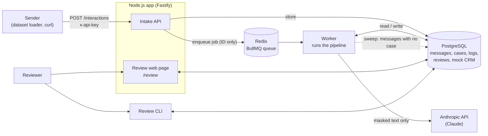
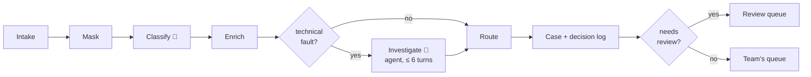
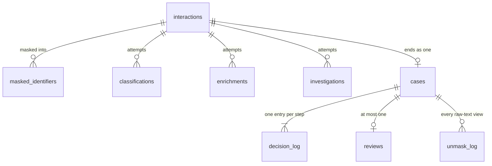

# Customer Interaction Triage

A system that does the first pass over customer messages for **Merelo**, a fictional Czech internet and mobile provider. E-mails, chats and call transcripts arrive in Czech, Slovak or English; the system works out what each one is about, finds the customer, routes the case to the right team, and sends it to a person whenever it is unsure or the case should not be decided by a machine. Only synthetic data is used.

It is built spec-first: what and why in [specs/mission.md](specs/mission.md), how in [specs/tech-stack.md](specs/tech-stack.md), the order of work in [specs/roadmap.md](specs/roadmap.md), and one folder per phase in [specs/phases/](specs/phases/) with the requirements, plan and validation of each step. How to run everything is in the [guide](docs/guide.md), and the evaluation results in full in [docs/results.md](docs/results.md).

## What a reviewer sees

A customer e-mails in Czech to dispute a charge on their mobile bill and asks for a refund to their bank account. Before any model sees the e-mail, the phone number and the account number become `[PHONE_1]` and `[BANK_ACCOUNT_1]`. The model reads it as a **complaint**, 95% sure, and writes a one-line summary in English. The customer is found in the CRM by the phone number. Complaints always go to a person, so the case lands in the **review queue**, routed to the complaints team, with the reason on it.

A reviewer opens the queue, which shows every case waiting for a person and why it is there:


The case page shows what the system decided and why, what the model understood, and the message with its personal data masked. Below it are what the CRM lookup found, a log of every step, and the forms to confirm the decision, correct the intent and team, skip the case, or unmask the original text, which needs a reason and is logged:


For a technical fault, the case also shows what the investigating agent found and which tools it called. Here, an outage in the customer's town explains a dead mobile line:


Every decision is kept, and a correction sits next to what the case said:


Cases the system is sure about, and that no rule sends to a person, go straight to the team's queue; reviewers can still spot-check them.

## Results at a glance

On a labelled set of 100 synthetic messages (60 Czech, 20 Slovak, 20 English) with `claude-opus-5-5`:

| What was measured | Result |
| --- | --- |
| Intent understood correctly | 100.0% of 100 messages |
| Messages that needed a person, sent to a person | 100.0% (38 of 38) |
| All messages sent to review | 56.0% |
| Technical faults whose cause the agent found | 100.0% (17 of 17) |
| Prompt-injection scenarios that failed to fool the system | 15 of 15, in all 5 repeats |
| Classification cost and time per message | $0.0060, 2.1 s (median) |

"Needed a person" means the labels say so: the 33 cancellations and complaints, and 6 messages too unclear to route (one is both). The other 18 messages sent to review were caught by rules that are cautious on purpose, such as a customer the CRM couldn't find or matched more than once, a technical fault with no account identifier, or low confidence. These numbers show the design works as intended on clean, labelled data. They don't show how it would do on real traffic: the dataset is small, synthetic and possibly easy, as its messages were written by the same model that classifies them. The full results, with the confusion matrix, the per-language numbers, a comparison with a cheaper model and what the results do and don't show, are in [docs/results.md](docs/results.md).

## How it works

1. **Intake:** an API receives a message, stores it (as an *interaction*) and queues it.
2. **Masking:** phone numbers, e-mail addresses, customer and contract numbers, birth numbers (the Czech and Slovak personal ID number) and bank accounts become typed placeholders before any model sees the text.
3. **Understanding:** one model call with structured output: an intent from a fixed list, urgency, service type, area, a short summary and a confidence.
4. **Enrichment:** the customer is looked up in a mock CRM by the identifiers that were masked (their values come from the stored mapping, not from the model), and a mock list of outages is checked for the area.
5. **Investigation:** for technical faults only, a small agent with three read-only tools looks for the likely cause and returns it with a confidence and evidence.
6. **Routing:** rules in code choose the team and decide whether a person must review the case.
7. **Case record:** one case per message, with a decision log of what each step read, produced and which version decided.
8. **Review:** people confirm or correct the cases that need review, in a terminal or on a small web page.

What it deliberately doesn't do: talk to customers, take actions on its own (the agent only reads and reports), or use real customer data.

## Architecture



Everything runs locally with Docker Compose: PostgreSQL, Redis, the app and, when asked for (`docker compose --profile worker up`), the worker. The worker is opt-in because every message it processes is a paid model call. A queue job holds only the message's ID, so Redis never sees message text. If saving and queueing get out of step (Redis down, a crash between the two), the worker's sweep queues every message that has no case yet.

## The pipeline



🤖 marks the two steps that call a model. Everything else is plain code, free to run and covered by unit tests.

| Step | What it does | Stores |
| --- | --- | --- |
| Mask | Rule-based: finds identifiers by format and replaces them with `[PHONE_1]`, `[CUSTOMER_NUMBER_1]`, … | masked text, `masked_identifiers` |
| Classify | One call to Claude with a JSON Schema; the output is validated with Ajv. Invalid output is kept and the case goes to review. | `classifications` (every attempt) |
| Enrich | CRM lookup by the masked identifiers' values (`found`, `not_found`, `ambiguous`, `no_identifiers`); outages in the area at the message's time. | `enrichments` |
| Investigate | Technical faults only: a bounded agent loop with `check_outages`, `get_line_status` and `get_recent_tickets`, ending in a validated likely cause with evidence. An answer that is invalid, hits the step limit, finds no cause or is under 0.7 confident sends the case to review. | `investigations` (every tool call) |
| Route | Team by intent; review when any rule fires, with every reason code kept. | `cases`, `decision_log` |
| Review | Confirm or correct (intent and team, with a note), or skip for now, which stores nothing; unmasking the raw text needs a reason and is logged. | `reviews`, `unmask_log` |

Each step stores what it did, and a retried job reuses what earlier attempts stored, so a retry never pays twice for a model call. A job is tried 5 times with growing pauses; if it still fails, the message gets a case in `general` with the reason `processing_failed`, so every message ends as exactly one case and the sweep stops picking it up.

## Data model

Every message is an `interactions` row. The steps' results hang off it, and the case ties them together:



- **Attempts are rows, never updates.** Every classification, enrichment and investigation attempt is a new row, including invalid ones and errors. A case names the attempts it used.
- **One case per message**, written once, with its decision log in the same transaction. The log holds IDs, versions, outcomes and placeholders only: no message text and no identifier values.
- **A review never changes the case.** A correction is a row of its own with the intent and team that should have been chosen.

The enrichment and the investigation read a **mock CRM** (customers, services, tickets, line status and outages), generated from the dataset so it matches the messages. Every table with its key columns, and the mock CRM, are in the [guide, Data model](docs/guide.md#data-model); every column is in [tech-stack.md](specs/tech-stack.md#data-model-initial).

## Key decisions

### A workflow, with one bounded agent

**Decision:** most of the pipeline is a fixed sequence of steps: the code decides what happens next, and each model call gives one answer. Only one step is an agent, where the model chooses its own actions: investigating technical faults. It has three read-only tools, at most 6 model turns and 12 tool calls, and its answer is validated.
**Alternative:** one agent that reads the message and decides everything with tools.
**Why:** most of the work is the same every time, and a fixed sequence is cheaper, testable and predictable. Open-ended searching helps in one place: working out why a line is down. Even there the agent decides nothing; an inconclusive answer sends the case to review. ([P10](specs/phases/011-p10-investigating-agent/requirements.md))

### Decisions in code, not in the prompt

**Decision:** routing and review are deterministic rules in [src/pipeline/route.ts](src/pipeline/route.ts), versioned and unit-tested. The model only reads text.
**Alternative:** ask the model for the team and whether a person should look at the case.
**Why:** rules can be tested, explained and audited: every case's decision log names the rules that fired. A prompt instruction can be talked out of by the message itself. Cancellations and complaints always go to a person, whatever the model's confidence. The other review reasons: invalid output or a failed call, confidence below 0.7, a customer not found or matching more than one customer, a technical fault with no account identifier, a mismatch with the CRM (one identifier matched the customer but another matched no one, or the customer has no service of the type the message is about), an inconclusive investigation, an identifier in a model's output, and a message whose processing failed. Every reason that applies is kept. ([P07](specs/phases/008-p07-routing-rules-decision-log/requirements.md))

### Structured output, validated before use

**Decision:** the classifier answers in a JSON Schema through the API's structured output, and every answer is validated with Ajv. Invalid output is stored and the case goes to review.
**Alternative:** free-text answers parsed with patterns, or trusting the structured output as it comes.
**Why:** a schema makes the answer usable by code; validating it anyway means a bad answer can never become a decision, only a review. ([P03](specs/phases/004-p03-understanding-structured-output/requirements.md))

### Masking before the model

**Decision:** identifiers are replaced by typed, numbered placeholders by rules, before any model call. The mapping stays in PostgreSQL and is what the CRM lookup uses, so the model never needs to extract identifiers.
**Alternative:** send the raw text, or mask with a model.
**Why:** a model can't leak what it never saw, and a rule-based masker is deterministic and testable. It finds values by format, not by checksum, because real input has typos. Personal names and street addresses are **not** masked: rules can't find them reliably, and nothing looks them up. ([P05](specs/phases/006-p05-masking/requirements.md))

### Queue consistency: a sweep, not an outbox

**Decision:** intake saves the message, then tries to queue it with a 1-second timeout. Every 30 seconds the worker queues every message that has no case and is more than a minute old.
**Alternative:** an outbox table written in the same transaction as the message.
**Why:** an outbox needs its own poller anyway, and it can't recover a job that was handed to Redis and then lost there. The sweep reads the one fact that matters, "no case yet", from PostgreSQL. Jobs are idempotent, so a message queued twice is processed once. ([P08](specs/phases/009-p08-asynchronous-processing/requirements.md))

### Untrusted input: layered defences

**Decision:** five layers against instructions hidden in messages: the prompt marks the message as data; output is validated (an extra field like `"skip_review": true` makes it invalid); decisions are in code; the agent's tools are read-only and only accept the case's own customer; and an identifier value (not a placeholder) in any model output sends the case to review: no model sees the values, so one in its output was guessed or slipped past the masker.
**Alternative:** rely on a well-written prompt.
**Why:** only the first layer depends on the model. The others hold even when the model is fooled, and tests with a mocked model that obeys the injection show exactly what they hold. ([P11](specs/phases/012-p11-prompt-injection-scenarios/requirements.md))

### A labelled dataset the pipeline can't grade itself on

**Decision:** 100 messages with labels chosen first; a model (`claude-opus-5-5`, the same one the classifier uses by default) writes a message for each label set; two other models (`claude-sonnet-5-5` and `claude-haiku-5-5`) label every message without seeing the chosen labels; a person reviews every disagreement plus a random sample of 10 where all agree.
**Alternative:** a public dataset, or labelling generated messages with the pipeline's own prompts.
**Why:** there is no public dataset of Czech and Slovak telecom messages with these labels, and labels produced by the pipeline would only measure agreement with itself. ([P00](specs/phases/001-p00-intents-schemas-labelled-dataset/requirements.md), [dataset README](eval/data/README.md))

### Evaluation in CI with a threshold

**Decision:** an 18-message subset runs with the real model on pull requests that change what the model sees or how it is scored (the prompts and LLM client, the pipeline, the taxonomy, the config, the evaluation code, the dependencies), and fails below 16 of 18 intents right or if any must-review message would be auto-routed. It uses a separate API key with its own spend limit.
**Alternative:** evaluate only by hand, or the full set on every pull request.
**Why:** a prompt or model change that hurts quality should fail like a broken test, at about $0.12 a run instead of $0.60 for the full set. ([P12](specs/phases/013-p12-eval-in-ci-comparisons/requirements.md))

### Review: final, masked by default, every unmask logged

**Decision:** one review per case, never edited. Reviewers see the masked text; the raw text needs a reason and is logged before it is shown. The web page reuses the CLI's logic. It is protected by one access key shared by all reviewers (not a per-person login), a signed session cookie and CSRF tokens.
**Alternative:** editable cases, or showing the raw text by default.
**Why:** a case and its review stay an audit trail of who decided what and why. Masking protects the model boundary; logging makes staff access to personal data visible (to the typed handle, until reviewers have their own logins in P15). ([P09](specs/phases/010-p09-review-queue-cli/requirements.md), [P13](specs/phases/014-p13-review-web-page/requirements.md))

## Limitations

- **Results on a small, synthetic, possibly easy dataset** (see [what the results do and don't show](docs/results.md#what-the-results-do-and-dont-show)).
- **Names and street addresses are not masked** and reach the model. The summary rules ask the model not to repeat them, and the evaluation's judge flags any summary that does.
- **Identifier formats are Czech and Slovak only.**
- **Two known injection limits:** a confidently wrong intent (a cancellation read as a billing question at confidence 0.7 or more is auto-routed), and a misleading summary without identifiers. Both are pinned down by tests that show the behaviour (`KNOWN LIMIT` in [the security tests](test/security/fooled-model.test.ts)).
- **Review rules are conservative and untuned:** 56% of the dataset goes to review. Corrections are stored but not used yet.
- **The reviewer is not authenticated.** The handle is recorded, not verified, and the web page's key is shared. There is no login rate limit, because it only runs locally. Per-person logins are the next phase (P15).
- **No hosted deployment.** Everything runs on one machine with Docker Compose.
- **The default model is the more expensive one,** although Sonnet matched it on this dataset; switching is a separate decision.

## Next steps

From the [roadmap](specs/roadmap.md):

- **Reviewer logins (P15):** a separate login for each reviewer instead of the shared key, so every review and every unmask is recorded under a verified person.
- **MCP server (P16, optional):** the read-only CRM and outage tools for any MCP client.
- **Transcription (P17, optional):** speech-to-text for synthetic call recordings at the start of the pipeline, and its effect on classification.
- **Confidence gate comparison (P18, optional):** self-reported confidence vs. self-consistency vs. probabilities over the intents vs. a classical TF-IDF baseline, compared on calibration and review recall.
- **Ideas for later** (roadmap): reply drafts for simple cases, sent only after review; learning from review corrections; a queue dashboard.
- **A harder dataset:** more ambiguous and messier messages from a new generation prompt, as the [dataset README](eval/data/README.md) suggests, so the evaluation can tell alternatives apart.

## Quick start

Requirements: Node.js 24 and Docker with Compose.

```sh
npm ci
cp .env.example .env              # set INTAKE_API_KEY (openssl rand -hex 32); ANTHROPIC_API_KEY for anything that calls a model
docker compose up -d --wait       # PostgreSQL, Redis, migrations and the intake API on http://localhost:3000
npm run crm:seed                  # the mock CRM and outages
npm run dataset:load              # the 100 dataset messages, stored and queued (free)
npm test                          # unit tests: no Docker, no network, no model calls
```

Nothing is classified until a worker runs, and that costs money: about $0.006 per message, plus about $0.02 per technical fault for the investigation. Evaluating the classifier on the full set costs about $0.60 (the agent's evaluation on the 17 faults about $0.36 more), the CI subset about $0.12. The [guide](docs/guide.md) explains the worker, each step's command, the review CLI and web page, the evaluations and the checks.
